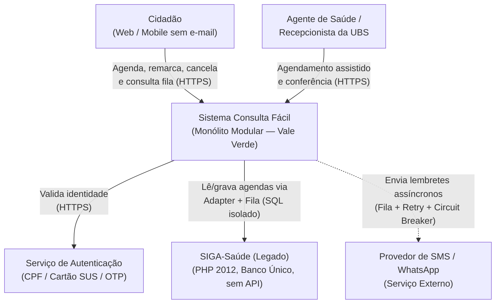

# 🏥 Consulta Fácil — Prefeitura de Vale Verde

-0f766e?style=flat-square)


> **Reorganização de Engenharia de Software e Protótipo Navegável Acessível** desenvolvidos pela **Equipe 10** para a Avaliação **A3 – Estudo de Caso Aplicado** da disciplina *Modelos, Métodos e Técnicas da Engenharia de Software* (UNIFACS — Prof. Alexandre de Cássio Rodrigues).

🔗 **Protótipo navegável (GitHub Pages):** `https://SEU-USUARIO.github.io/NOME-DO-REPOSITORIO/` *(substitua após ativar o GitHub Pages)*

---

## 📌 1. Visão Geral do Caso

**Vale Verde** é um município fictício de **210 mil habitantes** com **32 Unidades Básicas de Saúde (UBS)**. Atualmente, cidadãos enfrentam filas presenciais antes das 6h ou dependem de ligações telefônicas para agendar consultas, gerando **18% de faltas** e alto volume de reclamações na ouvidoria — sobretudo de **idosos e trabalhadores**.

As unidades operam com o **SIGA-Saúde**, um sistema legado desktop de 2012 escrito em PHP, com banco de dados único, sem API e documentação mínima, que centraliza prontuários, agendas e cadastros de pacientes.

Após um piloto terceirizado falhar no primeiro dia real de operação (abertura das vagas às 7h), nossa equipe foi acionada para estruturar um plano de engenharia confiável respeitando:

- **Prazo do financiamento estadual:** 1ª versão em operação em **3 UBS em até 3 meses** e expansão para todas as **32 UBS em 9 meses**.
- **Equipe da prefeitura:** **5 pessoas** (2 desenvolvedores, 1 analista de infraestrutura, 1 analista de suporte e 1 coordenadora).
- **Requisitos centrais:** conformidade com a **LGPD** (proteção de dados sensíveis de saúde) e alta **acessibilidade** para usuários com pouca familiaridade tecnológica.

---

## ⚠️ 2. Falhas do Piloto Anterior e Soluções Propostas

| # | Falha ocorrida no piloto (7h) | Solução adotada no projeto |
| :-: | :--- | :--- |
| 1 | ~4 mil acessos simultâneos deixaram o sistema lento por quase 2 horas | Cache de leitura para vagas disponíveis, testes de carga no CI/CD e liberação gradual escalonada com *Feature Flags* |
| 2 | Duas pessoas receberam confirmação para a mesma última vaga de pediatria | Transação ACID no banco relacional com *lock*/restrição `UNIQUE` no slot + idempotência e tela de exceção amigável |
| 3 | Queda do provedor de SMS gerou retentativas infinitas e derrubou o servidor | Desacoplamento via fila assíncrona, *timeout* curto, retentativa limitada com *backoff* exponencial e *Circuit Breaker* |
| 4 | Paciente idosa não conseguiu agendar porque o sistema exigia e-mail obrigatório | Identificação apenas com **CPF ou Cartão SUS + celular**, modo assistido por Agente de Saúde e conformidade **WCAG 2.2 AA** |
| 5 | Servidores "saudáveis" no painel, mas sem visibilidade de agendamentos falhos | Métrica de jornada do usuário (**% de agendamentos concluídos às 7h**) combinada com métricas **DORA** |
| 6 | Correção publicada direto em produção à noite apagou agendas, sem backup testado | Pipeline CI/CD obrigatório com PR, migrações versionadas, bloqueio de deploy manual, backup pré-deploy e testes de restauração (**RPO ≤ 5 min / RTO ≤ 30 min**) |

---

## 🏗️ 3. Arquitetura e Decisões Técnicas Principais



- **Estilo Arquitetural (ADR-001):** **Monólito Modular** (domínios de Agendamento, Notificação e Integração SIGA isolados internamente), priorizado sobre microsserviços pela coerência com a equipe de 5 pessoas (2 devs) e o prazo de 3 meses.
- **Padrão de Projeto:** **Adapter** encapsulando o acesso controlado ao banco do SIGA-Saúde (sem API), isolando tabelas legadas e restringindo acesso a prontuários (LGPD), em substituição a consultas SQL diretas espalhadas pela aplicação.
- **Processo e Transição:** **Prototipação Exploratória + Desenvolvimento Iterativo-Incremental (Scrum/Kanban)**, com migração das agendas do SIGA-Saúde em 4 etapas (**Preparar → Ensaiar → Validar → Transicionar**), incluindo reconciliação e *rollback* testado.
- **Privacidade (LGPD):** Notificações via SMS/WhatsApp contêm apenas data, horário, UBS e código validador — sem expor especialidade médica ou histórico clínico em canais de terceiros.

---

## 📱 4. Protótipo Navegável (`index.html`)

O protótipo foi construído em arquivo único (`HTML + CSS + JavaScript`), sem dependências externas, para **validar hipóteses de usabilidade e acessibilidade antes do investimento em código**.

### Jornada coberta
1. **Entrar:** acesso sem e-mail obrigatório (CPF ou Cartão SUS + celular) e alternador para **Agendamento Assistido por Agente de Saúde**.
2. **Escolher UBS e Especialidade:** cartões amplos (alvos de toque ≥ 48 px) listando as 3 UBS do piloto e alerta de poucas vagas em Pediatria.
3. **Escolher Horário:** seleção clara com dia, horário e profissional, destacando a última vaga de Pediatria (`08:30`).
4. **Tela de Exceção (obrigatória):** ao tentar reservar a última vaga (`08:30`), demonstra o tratamento acolhedor de concorrência (*"A vaga acabou de ser ocupada"*), preservando os dados preenchidos e oferecendo horários alternativos ou fila de espera por SMS.
5. **Confirmar e Comprovante:** resumo simples com aviso LGPD, garantia de reserva mesmo em caso de atraso no SMS e cancelamento protegido contra cliques repetidos.

### Recursos de Acessibilidade (WCAG 2.2)
- Alternador fixo de **Alto Contraste**;
- Controles de aumento e redução de fonte (`A+` / `A-`);
- Tipografia ampliada por padrão, barra de progresso por etapas e linguagem livre de jargões técnicos;
- Navegação rápida de demonstração no rodapé para facilitar avaliação e capturas de tela.

---

## 🚀 5. Como Executar Localmente

Não é necessário instalar pacotes nem executar etapas de *build*.

```bash
# 1. Clone o repositório
git clone [https://github.com/SEU-USUARIO/NOME-DO-REPOSITORIO.git](https://github.com/SEU-USUARIO/NOME-DO-REPOSITORIO.git)

# 2. Acesse a pasta do projeto
cd NOME-DO-REPOSITORIO

# 3. Abra o arquivo index.html diretamente no navegador
```

### Estrutura do Repositório

```text
.
├── index.html        # Protótipo navegável completo (HTML, CSS e JS)
├── docs/             # (Opcional) Diagrama em PNG e PDF final consolidado da A3
└── README.md         # Documentação do projeto
```

---

## 👥 6. Equipe 10

| Integrante | RA |
| :--- | :--- |
| **Amanda Amorim Peterka** | `825139353` |
| **Caio Icaro Santos da Costa** | `12724214667` |
| **Julia Tizuey Martins Hosoy** | `12721217749` |

> **Disciplina:** Modelos, Métodos e Técnicas da Engenharia de Software — UNIFACS (2026.2)  
> **Professor:** Alexandre de Cássio Rodrigues

---

## 🤖 7. Declaração de Uso de Inteligência Artificial

Conforme as diretrizes da disciplina, ferramentas de inteligência artificial generativa (**Gemini** e **Claude**) foram utilizadas como suporte na geração do protótipo navegável em HTML/CSS/JS, organização estrutural da documentação e discussão de alternativas técnicas. Todas as decisões de arquitetura, requisitos, processo e validação no contexto de Vale Verde foram revisadas e assumidas integralmente pela Equipe 10.

---

## 📚 8. Referências

- BRASIL. **Lei nº 13.709, de 14 de agosto de 2018**. Lei Geral de Proteção de Dados Pessoais (LGPD). Brasília, DF: Presidência da República, 2018.
- BROWN, Simon. **The C4 model for visualising software architecture**. 2024. Disponível em: https://c4model.com/.
- FORSGREN, Nicole; HUMBLE, Jez; KIM, Gene. **Accelerate: the science of lean software and DevOps**. Portland: IT Revolution Press, 2018.
- GAMMA, Erich et al. **Padrões de projetos: soluções reutilizáveis de software orientado a objetos**. Porto Alegre: Bookman, 2000.
- SCHWABER, Ken; SUTHERLAND, Jeff. **O Guia do Scrum**. Nov. 2020. Disponível em: https://scrumguides.org/.
- SOMMERVILLE, Ian. **Engenharia de software**. 10. ed. São Paulo: Pearson Education do Brasil, 2019.
- W3C. **Web Content Accessibility Guidelines (WCAG) 2.2**. W3C Recommendation, 5 out. 2023. Disponível em: https://www.w3.org/TR/WCAG22/.
